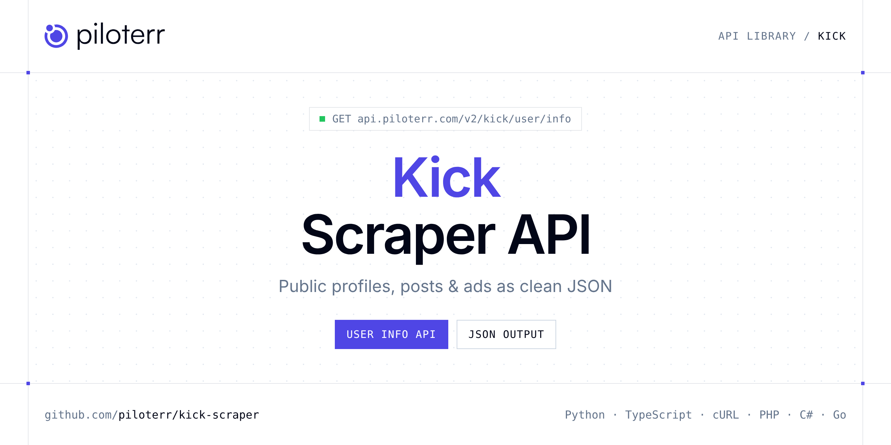

<p align="center">
  <a href="https://www.piloterr.com"></a>
</p>

# Kick Scraper API

[](https://discord.gg/CFj3ph8aHU) [](https://app.piloterr.com) [](https://app.piloterr.com/openapi) [](LICENSE)

The **Piloterr Kick Scraper API** lets you extract public data from Kick as **clean, structured JSON** — no proxies, headless browsers or HTML parsing to maintain. Endpoints available in production:

- **Kick User Info API** — Retrieve complete public channel data from Kick including streamer profile, follower count, live status, and recent categories.

Use it for brand monitoring, social listening, influencer research, ad intelligence or content analytics on public data.

| Endpoint | Path | Credits | What you get |
|---|---|---|---|
| [Kick User Info API](#kick-user-info-api) | `/v2/kick/user/info` | 1 | Retrieve complete public channel data from Kick including streamer profile, follower count, live status, and recent categories. |

## Table of contents

- [How it works](#how-it-works)
- [Kick User Info API](#kick-user-info-api)
- [Code examples in other languages](#code-examples-in-other-languages)
- [Practical use cases](#practical-use-cases)
- [Why Piloterr?](#why-piloterr)
- [FAQ](#faq)
- [Official SDKs](#official-sdks)
- [Related scrapers](#related-scrapers)
- [Support](#support)

## How it works

1. **Create a free Piloterr account** and copy your API key from the [dashboard](https://app.piloterr.com).
2. **Send a `GET` (or `POST`) request** to `https://api.piloterr.com/v2/...` with the header `x-api-key: YOUR_API_KEY`.
3. **Receive structured JSON** — Piloterr handles rendering, proxies, retries and parsing.

```bash
export PILOTERR_API_KEY="your-api-key"
pip install requests        # Python
# TypeScript: Node.js 18+ (native fetch), run with `npx tsx file.ts`
```

> Every endpoint accepts both `GET` (query string) and `POST` (JSON body with the same fields).

## Kick User Info API

Retrieve complete public channel data from Kick including streamer profile, follower count, live status, and recent categories.

`GET | POST https://api.piloterr.com/v2/kick/user/info` · **1 credit per request** · [Full reference](https://app.piloterr.com/openapi)

### Request parameters

| Parameter | Type | Required | Description |
|---|---|---|---|
| `query` | string | ✅ | The Kick channel to look up. Accepts a full channel URL or a username/slug. |

### Python example

```python
import json
import os
import requests

response = requests.get(
    "https://api.piloterr.com/v2/kick/user/info",
    headers={"x-api-key": os.environ["PILOTERR_API_KEY"]},
    params={
        "query": "https://kick.com/example-user",
    },
    timeout=120,
)
response.raise_for_status()
data = response.json()

print(json.dumps(data, indent=2, ensure_ascii=False)[:2000])
```

### TypeScript example

```typescript
type KickUserInfo = {
  id?: number;
  role?: unknown;
  slug?: string;
  user?: {
    id?: number;
    bio?: string;
    city?: unknown;
    gender?: unknown;
    discord?: string;
    twitter?: string;
    youtube?: string;
    username?: string;
    instagram?: string;
    profile_pic?: string;
  };
  muted?: boolean;
  user_id?: number;
  verified?: boolean;
  is_banned?: boolean;
  livestream?: unknown;
  vod_enabled?: boolean;
  banner_image?: {
    url?: string;
  };
  playback_url?: string;
  follower_badges?: unknown[];
  followers_count?: number;
  recent_categories?: {
    id?: number;
    name?: string;
    slug?: string;
    tags?: string[];
  }[];
  subscription_enabled?: boolean;
};

const params = new URLSearchParams({
  "query": "https://kick.com/example-user",
});

const response = await fetch(`https://api.piloterr.com/v2/kick/user/info?${params}`, {
  headers: { "x-api-key": process.env.PILOTERR_API_KEY! },
});
if (!response.ok) throw new Error(`Piloterr error ${response.status}: ${await response.text()}`);

const data = (await response.json()) as KickUserInfo;

console.log(JSON.stringify(data, null, 2).slice(0, 2000));
```

<details>
<summary><b>POST variant</b></summary>

```http
POST https://api.piloterr.com/v2/kick/user/info
x-api-key: YOUR_API_KEY
Content-Type: application/json

{"query": "https://kick.com/example-user"}
```
</details>

### Output example

Response shape with placeholder values — field names follow the API reference.

```json
{
  "id": 0,
  "role": "example",
  "slug": "example",
  "user": {
    "id": 0,
    "bio": "example",
    "city": "example",
    "gender": "example",
    "discord": "example",
    "twitter": "example",
    "youtube": "example",
    "username": "example",
    "instagram": "example",
    "profile_pic": "example"
  },
  "muted": false,
  "user_id": 0,
  "verified": false,
  "is_banned": false,
  "livestream": "example",
  "vod_enabled": false,
  "banner_image": {
    "url": "example"
  },
  "playback_url": "example",
  "follower_badges": [
    "example"
  ],
  "followers_count": 0,
  "recent_categories": [
    {
      "id": 0,
      "name": "example",
      "slug": "example",
      "tags": []
    }
  ],
  "subscription_enabled": false
}
```

### Response fields

| Field | Type | Description |
|---|---|---|
| `id` | integer |  |
| `role` | object |  |
| `slug` | string |  |
| `user` | object |  |
| `user.id` | integer |  |
| `user.bio` | string |  |
| `user.city` | object |  |
| `user.gender` | object |  |
| `user.discord` | string |  |
| `user.twitter` | string |  |
| `user.youtube` | string |  |
| `user.username` | string |  |
| `user.instagram` | string |  |
| `user.profile_pic` | string |  |
| `muted` | boolean |  |
| `user_id` | integer |  |
| `verified` | boolean |  |
| `is_banned` | boolean |  |
| `livestream` | object |  |
| `vod_enabled` | boolean |  |
| `banner_image` | object |  |
| `banner_image.url` | string |  |
| `playback_url` | string |  |
| `follower_badges` | any[] |  |
| `followers_count` | integer |  |

## Code examples in other languages

Ready-to-run examples live in the [`examples/`](examples) folder. Each one reads your key from the `PILOTERR_API_KEY` environment variable.

| Language | User Info |
|---|---|
| cURL (Bash) | [`user-info`](examples/curl/user_info.sh) |
| PHP | [`user-info`](examples/php/user_info.php) |
| C# | [`user-info`](examples/csharp/UserInfo.cs) |
| Go | [`user-info`](examples/go/user_info.go) |
| Java | [`user-info`](examples/java/UserInfoExample.java) |
| Ruby | [`user-info`](examples/ruby/user_info.rb) |
| Node.js | [`user-info`](examples/nodejs/user_info.mjs) |

## Practical use cases

- **Brand monitoring** — Follow public mentions and engagement around your brand.
- **Social listening** — Analyse public conversations and trends.
- **Influencer research** — Qualify public creator profiles and audience metrics.
- **Ad intelligence** — Study competitors' public ads and creatives.
- **Content analytics** — Benchmark formats and engagement over time.

## Why Piloterr?

- **No infrastructure** — no proxies, headless browsers or CAPTCHA solving to run yourself.
- **Structured JSON** — stable, documented fields instead of brittle HTML selectors.
- **Pay per request** — transparent credit cost per endpoint, failed requests are retried for you.
- **One API key, hundreds of sources** — Kick plus many other e-commerce, search and company data endpoints in the [Piloterr library](https://www.piloterr.com/library).
- **Any language** — plain HTTPS + JSON, with examples for Python, TypeScript, cURL, PHP, C#, Go, Java, Ruby and Node.js.

## FAQ

### Is it legal to scrape Kick?

Collecting publicly available data is generally allowed in many jurisdictions, but rules depend on your country, the data you collect and how you use it. Avoid personal data unless you have a lawful basis, respect the website's terms where they apply, and get legal advice for your specific use case. This is not legal advice.

### Do I need proxies or a headless browser?

No. Piloterr handles rendering, proxy rotation and retries on its side. You only send an HTTPS request with your `x-api-key` header and receive JSON.

### How much does a request cost?

Credits per call: `/v2/kick/user/info` **1**. See the [Piloterr website](https://www.piloterr.com) for plans.

### What data does the Kick API return?

Each endpoint returns structured JSON: **Kick User Info** — `id`, `role`, `slug`, `user`, `user.id`, `user.bio`.

### Which languages are supported?

Any language that can make an HTTP request. This README shows Python and TypeScript; the [`examples/`](examples) folder contains cURL, PHP, C#, Go, Java, Ruby and Node.js.

## Official SDKs

Use Piloterr from your own language with a typed client:

| SDK | Package | Install |
| --- | --- | --- |
| Node.js | [`@piloterr/sdk`](https://www.npmjs.com/package/@piloterr/sdk) | `npm install @piloterr/sdk` |
| Python | [`piloterr`](https://pypi.org/project/piloterr/) | `pip install piloterr` |
| Go | [`piloterr-go`](https://pkg.go.dev/github.com/piloterr/piloterr-go) | `go get github.com/piloterr/piloterr-go` |
| .NET | [`Piloterr`](https://www.nuget.org/packages/Piloterr) | `dotnet add package Piloterr` |
| Ruby | [`piloterr`](https://rubygems.org/gems/piloterr) | `gem install piloterr` |
| PHP | [`piloterr/sdk`](https://packagist.org/packages/piloterr/sdk) | `composer require piloterr/sdk` |
| Java | [`piloterr-java`](https://github.com/piloterr/piloterr-java) | build from source, see its README |
| CLI | [`@piloterr/cli`](https://www.npmjs.com/package/@piloterr/cli) | `npm install -g @piloterr/cli` |
| MCP server | [`@piloterr/mcp`](https://www.npmjs.com/package/@piloterr/mcp) | `npx -y @piloterr/mcp` |

## Related scrapers

- [Instagram Scraper API](https://github.com/piloterr/instagram-scraper)
- [Patreon Scraper API](https://github.com/piloterr/patreon-scraper)
- [Pinterest Scraper API](https://github.com/piloterr/pinterest-scraper)
- [TikTok Top Ads Scraper API](https://github.com/piloterr/tiktoktopads-scraper)
- [Weibo Scraper API](https://github.com/piloterr/weibo-scraper)
- [X (Twitter) Scraper API](https://github.com/piloterr/twitter-x-scraper)
- [All Piloterr scrapers on GitHub](https://github.com/piloterr)

## Support

- 💬 Join the [Piloterr Discord](https://discord.gg/CFj3ph8aHU) to ask questions and share what you build.
- 📚 Browse the [API reference (OpenAPI)](https://app.piloterr.com/openapi) and the [Piloterr library](https://www.piloterr.com/library).
- 🔑 [Get your API key](https://app.piloterr.com).

---

<p align="center">
  <a href="https://www.piloterr.com">
    <picture>
      <source media="(prefers-color-scheme: dark)" srcset="images/logo-dark.svg">
      
    </picture>
  </a>
  <br>
  <sub>Built by <a href="https://www.piloterr.com">Piloterr</a> — web scraping APIs for e-commerce, search, real estate and more, one API key.</sub>
</p>

<sub>Kick is a trademark of its respective owner. This repository is not affiliated with or endorsed by Kick. Examples are released under the MIT license.</sub>
